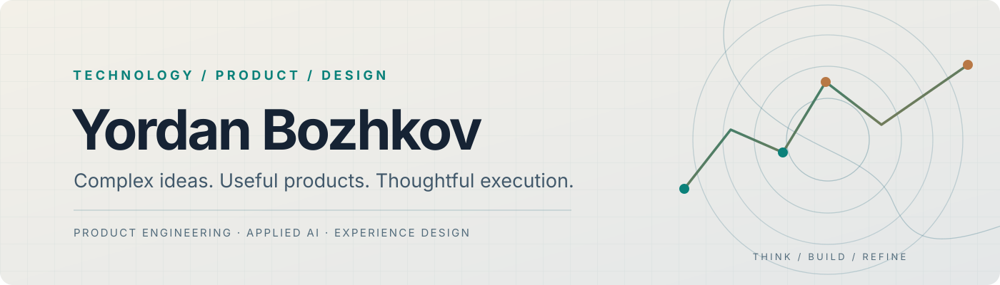
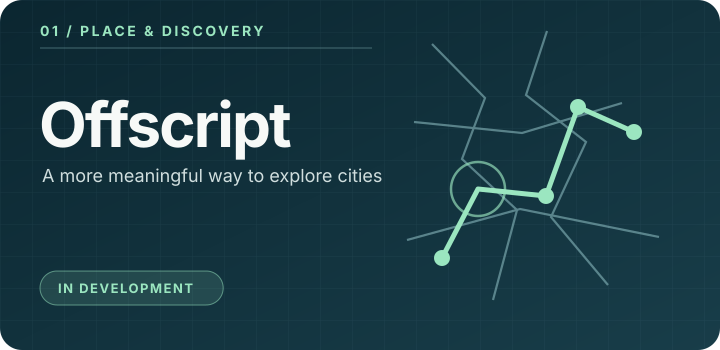
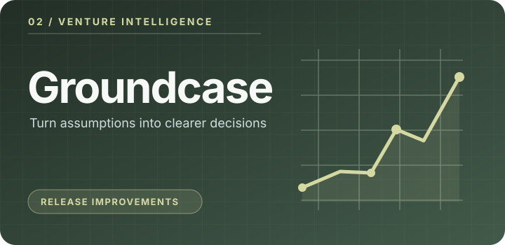
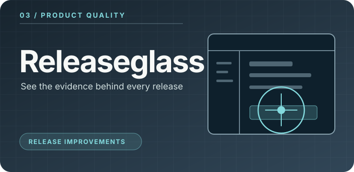
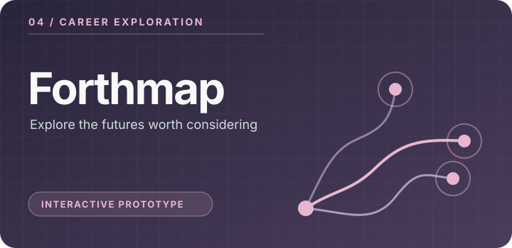

<!--
GitHub portfolio v2 | Public profile README.
Product covers are editorial illustrations, not captured product screens.
Release status must be kept factual; see docs/PORTFOLIO_STANDARD.md.
-->

<picture>
  <source media="(prefers-color-scheme: dark)" srcset="assets/hero-dark.svg">
  <source media="(prefers-color-scheme: light)" srcset="assets/hero-light.svg">
  
</picture>

  <strong>Technology &amp; product builder</strong> &nbsp;·&nbsp; Software systems &nbsp;·&nbsp; Applied AI &nbsp;·&nbsp; Experience design

  <a href="#selected-work">Selected work</a> &nbsp;·&nbsp;
  <a href="#what-i-bring-to-the-table">Capabilities</a> &nbsp;·&nbsp;
  <a href="#how-i-approach-the-work">Approach</a> &nbsp;·&nbsp;
  <a href="#lets-connect">Connect</a>

 

I work at the intersection of **product strategy, software engineering and considered design**. I enjoy taking an ambitious idea from the first question through to a real, usable experience—then challenging the result until it earns its place in someone's workflow.

My focus is not technology for its own sake. It's **building things that are useful, coherent and worth using**.

## Selected work

Four different questions. Four different product directions. Each has its own design identity, technical challenges and release path.

<table>
<tr>
<td width="50%" valign="top">
  
   <strong>Offscript</strong> 
  Historical discovery and meaningful city exploration.
</td>
<td width="50%" valign="top">
  
   <strong>Groundcase</strong> 
  Bringing structure to early-stage business decisions.
</td>
</tr>
<tr>
<td width="50%" valign="top">
  
   <strong>Releaseglass</strong> 
  Connecting product quality to real evidence.
</td>
<td width="50%" valign="top">
  
   <strong>Forthmap</strong> 
  Helping people explore potential career directions.
</td>
</tr>
</table>

**Portfolio transparency:** these are custom editorial illustrations, not screenshots of shipping software. The products below are in development or prototype stages, not presented as publicly released or generally available.

### 01 / Offscript

**City discovery, beyond the usual tourist checklist.** A location-based exploration experience intended to connect places with historical stories, walking and the joy of discovering a city.

**Current stage:** In development, including interface and experience exploration.

### 02 / Groundcase

**Clearer thinking for uncertain business decisions.** A local-first decision-intelligence product exploring venture assumptions, financial scenarios, evidence and choice-making.

**Current stage:** Release improvements. The available local build has substantive functionality, but owner acceptance is still pending, including first-use experience improvements.

### 03 / Releaseglass

**Know what you are shipping—not just what passed.** A product-review workspace built around actual journeys, screenshots, issue evidence and human release decisions.

**Current stage:** Release improvements. The local build requires a corrected first-use workflow and further design review before release acceptance.

### 04 / Forthmap

**Your future has more than one possible shape.** A career-exploration concept investigating different professional paths through interactive visual experiences.

**Current stage:** Interactive prototype; not a released service.

> **Next step for the portfolio:** as individual products pass their release reviews, they'll receive dedicated public case-study repositories with real interface captures, verified capabilities, design decisions and demo links where available.

## What I bring to the table

| Product thinking | Engineering & systems | Experience & design |
| :--- | :--- | :--- |
| Problem framing, strategy and prioritisation | Application architecture and practical automation | Interaction models and visual direction |
| Defining meaningful user journeys | Applied AI with purposeful human control | Design systems, clarity and accessibility |
| Turning ideas into reviewable products | Reliability, testing and release evidence | Detail, coherence and usability |

The tools and frameworks change with the problem. The aim stays the same: **thoughtful decisions and dependable experiences**.

## How I approach the work

**01 — Start with the real problem.** A useful product needs a clear human purpose before it needs a long feature list.

**02 — Make design part of the engineering.** An interface isn't finished just because the endpoints and tests work.

**03 — Treat AI as a capability, not a requirement.** Apply intelligence where it genuinely improves the experience; keep people in control.

**04 — Earn the release.** Green checks are important, but real workflows, honest limitations and human acceptance matter just as much.

## Beyond the build

I care about the full journey: **discovery → product direction → implementation → evidence → refinement**.

This GitHub profile is intentionally a *portfolio*, not a mirror of local development repositories or a scoreboard for commit activity. Product source and private project history remain in their respective development environments.

For how future product case studies are prepared, see the [portfolio publishing standard](docs/PORTFOLIO_STANDARD.md). The [showcase template](docs/PRODUCT_SHOWCASE_TEMPLATE.md) keeps future releases consistent and evidence-based.

## Let's connect

I'm interested in thoughtful conversations about product engineering, applied AI, founder-led technology and creating software with a point of view.

**[Explore my GitHub profile](https://github.com/yordanbozhkov)** · [Browse the portfolio repository](https://github.com/yordanbozhkov/yordanbozhkov)

---

Designed as a growing portfolio of work. No invented usage metrics, public-release claims or simulated contribution statistics.
